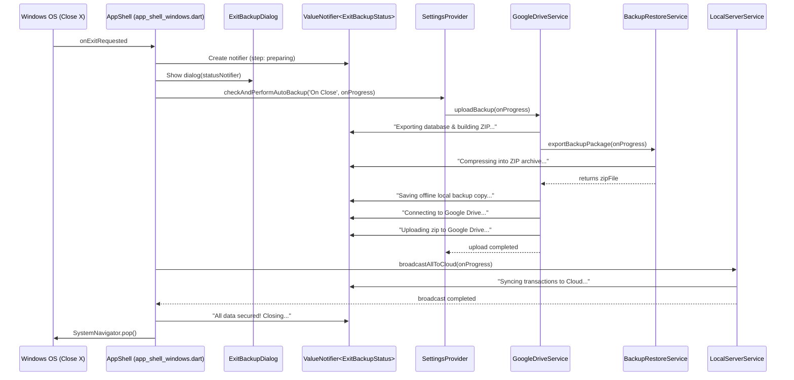

# Exit Backup Detailed Progress Implementation Plan

**Goal:** Enhance the Windows exit backup dialog (`ExitBackupDialog`) so that it elaborates in real time on exactly what the backup process is doing (e.g., preparing data, compressing into ZIP, saving local copy, connecting to Google Drive, uploading archive, and mirroring cloud changes).

**Architecture:** Introduce a reactive `ExitBackupStatus` model with a `ValueNotifier` passed from `app_shell_windows.dart` into `ExitBackupDialog`. Thread progress callbacks (`onProgress`) through `SettingsProvider`, `GoogleDriveService`, `BackupRestoreService`, and `LocalServerService` so each phase emits granular title, detail description, active step index, and fractional progress.

**Tech Stack:** Flutter / Dart, `ValueNotifier` / `ValueListenableBuilder`, `ZipFileEncoder` (archive), Google Drive API, Provider.

---

## 1. Problem Analysis & Current State

Currently, in `lib/widgets/exit_backup_dialog.dart`:
- The dialog shows a static title: *"Securing Your Data"*
- A static subtitle: *"Performing a quick backup to Google Drive before closing. Please wait a moment..."*
- A static status box: *"Syncing MediPoss Hub Database..."*
- There is no feedback about:
  1. Exporting ObjectBox tables to JSON
  2. Compressing files and media into a `.zip` archive
  3. Saving offline local backup copy
  4. Authenticating and connecting to Google Drive
  5. Uploading the ZIP archive to Google Drive
  6. Mirroring pending transactions to Firebase/Cloud
  7. Completion / final exit

Users cannot tell if the app is frozen, packaging data, or waiting for network upload.

---

## 2. Proposed User Experience & Stages

### Visual Stages
| Step | Stage Name | Visual Icon | Headline | Detail Description |
| :--- | :--- | :--- | :--- | :--- |
| **0** | **Preparing** | `Icons.hourglass_top_rounded` | *Preparing Backup* | "Collecting system state and calculating delta changes..." |
| **1** | **Packaging (ZIP)** | `Icons.folder_zip_rounded` | *Creating Zip Archive* | "Exporting medicines, sales, OPD records & compressing into ZIP..." |
| **2** | **Local Save** | `Icons.save_rounded` | *Saving Offline Copy* | "Storing secure local backup copy in application documents..." |
| **3** | **Google Drive** | `Icons.cloud_upload_rounded` | *Uploading to Google Drive* | "Connecting to Drive API & uploading backup archive..." |
| **4** | **Cloud Sync** | `Icons.cloud_sync_rounded` | *Syncing Cloud Mirror* | "Broadcasting latest clinic mutations to Cloud..." |
| **5** | **Complete** | `Icons.check_circle_rounded` | *Backup Complete!* | "All data secured successfully. Closing MediPoss..." |

### UI Design Upgrades in `ExitBackupDialog`:
1. **Dynamic Stage Header**: Animated icon that adapts color and glyph based on the active stage.
2. **Horizontal Step Indicator**: Visual chips (`1. Zip Archive`, `2. Local Backup`, `3. Google Drive`, `4. Cloud Sync`) showing checked (green), active (pulsing primary), and pending (grey) states.
3. **Primary & Secondary Feedback**:
   - Bold status heading: *"Creating Zip Archive..."*
   - Explanatory subtext: *"Compressing 14 database tables and patient attachments into mediposs_delta_...zip"*
4. **Animated Progress Indicator**: Linear progress bar with percentage or smooth indeterminate pulse per stage.
5. **Emergency Force Exit**: Kept at the bottom as *"Close without Backup"*, with tooltip explaining data will remain on disk.

---

## 3. Architecture & Data Flow

---

## 4. Implementation Tasks

### Task 1: Create `ExitBackupStatus` Model
- **File:** `lib/shared/models/exit_backup_status.dart`
- **Fields:**
  - `final ExitBackupPhase phase;` (`preparing`, `makingZip`, `savingLocal`, `uploadingDrive`, `syncingCloud`, `complete`, `error`)
  - `final String title;` (e.g., "Creating Zip Archive")
  - `final String detail;` (e.g., "Compressing database records & patient attachments...")
  - `final int currentStep;` (1-4)
  - `final int totalSteps;` (4)
  - `final double? progressFraction;` (0.0 to 1.0, or null for indeterminate)
  - `final bool isComplete;`
  - `final String? errorMessage;`

### Task 2: Thread Progress Callbacks in `BackupRestoreService` & `GoogleDriveService`
- **File:** `lib/shared/services/backup_restore_service.dart`
  - Update `exportBackupPackage({DateTime? since, void Function(String stage, String detail)? onProgress})`
  - Emit status during JSON export: `"Exporting database tables..."`
  - Emit status during media export: `"Copying media folders..."`
  - Emit status during ZIP compression: `"Compressing into ZIP archive (${p.basename(zipFilePath)})..."`
- **File:** `lib/shared/services/google_drive_service.dart`
  - Update `uploadBackup({DateTime? since, void Function(String stage, String detail, double? progress)? onProgress})`
  - Step 1: Forward to `generateBackupZip(onProgress: ...)`
  - Step 2: `"Saving offline local copy..."`
  - Step 3: `"Connecting to Google Drive..."`
  - Step 4: `"Uploading ZIP archive to Google Drive..."`
  - Step 5: `"Cleaning up temporary staging files..."`

### Task 3: Thread Progress in `SettingsProvider` & `LocalServerService`
- **File:** `lib/shared/providers/settings_provider.dart`
  - Update `checkAndPerformAutoBackup(String trigger, {void Function(String stage, String detail, double? progress)? onProgress})`
  - Pass `onProgress` down to `_googleDrive.uploadBackup(...)`
- **File:** `lib/shared/services/local_server_service.dart`
  - Add optional `void Function(String detail)? onProgress` to `broadcastAllToCloud()`
  - Emit: `"Broadcasting local database mirror to Cloud..."`

### Task 4: Revamp `ExitBackupDialog` UI
- **File:** `lib/widgets/exit_backup_dialog.dart`
  - Accept `final ValueNotifier<ExitBackupStatus> statusNotifier;`
  - Wrap UI in `ValueListenableBuilder<ExitBackupStatus>`
  - Render:
    1. Dynamic animated icon header (ZIP / Drive / Cloud / Check)
    2. Dynamic title and subtext
    3. Visual step tracker pill row (Zip -> Local -> Drive -> Cloud)
    4. Progress bar with smooth animation
    5. Clean "Close without Backup" emergency escape button

### Task 5: Integrate in `lib/screens/windows/app_shell_windows.dart`
- In `_showExitBackupDialog()`:
  - Instantiate `final statusNotifier = ValueNotifier<ExitBackupStatus>(ExitBackupStatus.initial());`
  - Pass `statusNotifier` to `ExitBackupDialog`.
  - Pass progress updater into `checkAndPerformAutoBackup` and `broadcastAllToCloud`.
  - On completion: set status to `complete` ("All data secured! Closing MediPoss..."), wait 400ms for visual polish, then invoke `SystemNavigator.pop()`.

---

## 5. Verification Plan

1. **Unit Tests:**
   - Verify `ExitBackupStatus` copyWith, phase helpers, and progress bounds.
   - Test callback invocations in `BackupRestoreService.exportBackupPackage` and `GoogleDriveService.uploadBackup`.
2. **Static Analysis:**
   - Run `flutter analyze` on touched files.
3. **Manual Verification on Windows:**
   - Launch app on Windows desktop.
   - Click close button (X) on top-right window bar.
   - Verify dialog appears immediately with dynamic step:
     - Shows *"Creating Zip Archive"* while packaging ObjectBox tables and media.
     - Shows *"Saving Offline Copy"* while copying to local backups folder.
     - Shows *"Connecting to Google Drive"* and *"Uploading to Google Drive"* with ZIP filename.
     - Shows *"Syncing Cloud Mirror"* if Firebase sync is enabled.
     - Shows *"Backup Complete!"* with green checkmark before window closes.
   - Verify clicking *"Close without Backup"* immediately exits the app.

